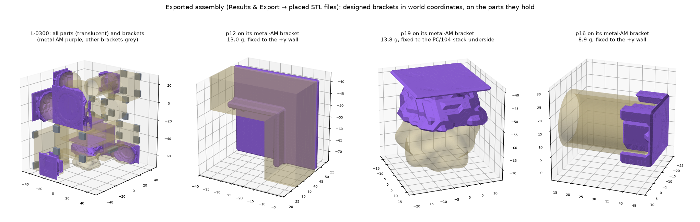
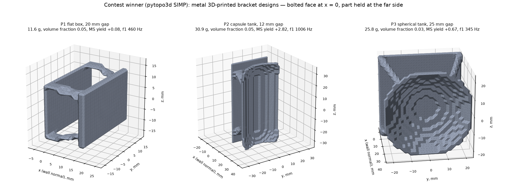

# TEXT-TO-SPACESHIP V2 — what is new

V2 is a copy of V1 (same history up to the V1 release) with the additions below. Everything V1 does, V2 does; V1 and
V2 can run side by side (V1 port 8765, V2 port 8766). All engineering values are ASSUMED unless a source is given;
the research notes behind them are in [docs/research](research), and the full notes (sources, tables, tests) of the
work behind §2.1, §5, §8 and §9 in [docs/notes](notes) (ws1, ws3, ws2, ws6). V1's own documents (STATUS.md, FINAL-REPORT.md,
PROTOCOL.md) describe V1, where a part could also be fixed to the PC/104 deck; V2 fixes every part to the chassis
(§2.1).

## 1. Part size slider and "Find largest size that fits" (Stage 2)

* **Part size 50–100 %** scales every part in all three axes: geometry × s, volume and computed mass × s³, inertia
  × s⁵; masses you typed in are kept. The frame, clearances and brackets are not scaled. Moving the slider starts a
  new search; every layout keeps the size it was found at, and its fit proof and certificate record that size (the
  stand-alone checker rebuilds the scaled parts from the original STL files).
* **Find largest size that fits** bisects the size to 1 %: at each size a fixed-effort Stage 2 search (same seed and
  budget) looks for a layout meeting every rule, and its best layout is certified by the validator. The answer is
  **search-based**: "not found" at a size does not prove that no layout exists there. Every size tried is listed;
  **Use it** sets the slider.

## 2. Brackets modelled in Stage 2 (part of the packing and of the proof)

Every part except the PC/104 boards is held by a bracket from its mounting side (the side with the 3 mm layer) to
**chassis structure only**: a wall, an end plate or a corner rail up to 40 mm away, never another part. The boards
hang on four rods from an end plate (§2.1). The bracket owns a **reserved box** from the target surface to the part
side, reaching into the part's bounding box where it wraps the part (clamps, cradles, metal-AM brackets). The box
keeps **1.2 mm** from every other part, every other bracket and every keep-out except the one it is fixed to — so
brackets compete for space exactly like parts. This replaces V1's "side 3–8 mm from a wall" rule.

* **Bracket-aware placement:** the decoder that packs the parts knows about the brackets. It does not only check
  them afterwards.
  * **Charging candidates:** every candidate position is charged by whether a bracket could hold the part there.
    The part's 3 mm mounting layer has to face a wall or corner rail within 40 mm. The corridor to it must be clear:
    1.2 mm from parts, keep-outs and other corridors.
  * **Reserving corridors:** the chosen corridor is reserved, so later parts cannot block the bracket. For a
    curved or irregular mounting side, the corridor also covers the region where a cradle, clamp or wrapping
    metal-AM bracket reaches around the part.
  * **Extra candidates:** for a layer that faces a side wall, each extreme point is also tried pinned against that
    wall.
  * **Fallback orientations:** when the keyed orientation cannot be mounted, other orientations are tried.
  * **End plates:** a bracket to an end plate is a last resort. The COM shift that follows (below) would carry
    the part away from the plate.

  The fallback stops at the first orientation that reaches a wall or rail. That cut a 3U decode from 516 to 177 ms
  (geometry-only: 101 ms). The exact bracket check (reserved box, cheapest option, clearances) still decides
  afterwards. Before this, the packer built tight clusters from the −Z end plate, and interior parts had no wall
  within reach. No layout was feasible in any form factor: in 750 random chromosomes, not one had every part
  mounted. With it, a 1,230-evaluation search found validator-certified layouts at 3U 50 / 54 / 75 %, 6U 50 / 75 /
  100 % and 12U 50 / 100 % (before v2.5; the v2.5 rules are measured in §2.1). 3U at full size still does not fit:
  the 19 parts with their bracket space overflow the 340.5 mm length (search-based, not proven).
* **Bracket budget slider (0–100), "0 = simple, 100 = 3D printed":** simple brackets are direct fasteners, a
  machined block, a sheet-metal Z-bracket, a tube clamp and a machined cradle. The budget sets how much more a
  **metal 3D-printed** bracket may cost than the cheapest simple bracket that fits and still be chosen. A part
  bolted straight to its wall (direct mount) keeps its fasteners. The relative hardware cost C is an objective
  weighted by (100 − budget). The steps keep the search from restarting at every slider move: it restarts only
  when the slider crosses one, as with 0.

  | Budget | Metal AM is chosen… | Brackets per layout, 6U 50 % (mean of 20 decodes, before v2.5) |
  |---|---|---|
  | 0 | never | 6.2 cradles, 2 clamps, 7.2 direct |
  | 1–33 | only where no simple bracket fits | 1.4 metal AM |
  | 34–66 | where it costs ≤ 2× the simple one (it replaces machined cradles) | 7.6 metal AM, 2 clamps |
  | 67–99 | where it costs ≤ 10× (also blocks, sheet brackets, clamps) | 8.6 metal AM, 1 clamp |
  | 100 | wherever it fits | 9.6 metal AM, 7.2 direct |

  Before this, metal AM was only a fallback at any budget, so even at 100 almost no 3D-printed brackets appeared.
* **Metal-AM bracket envelope:**
  * **Wrapping first:** a metal-AM bracket first takes the envelope of the machined cradle it replaces: the whole
    mounting side, reaching 30 % of the part's depth around it (4–15 mm). Its design then holds the part, as a
    bolted plate with a cup or saddle that follows the part, joined by optimised ribs.
  * **Compact fallback:** only where every other option to every target is blocked does it fall back to a
    compact pad (4 mm over 80 % of the side).
  * **A clearance bug this exposed:** the exact bracket check compared clearances strictly. A box exactly at
    1.202 mm from what the part was packed flush against (usually a corner rail) read as "blocked" through
    rounding (1.20199…). It now allows 1 µm, as the decoder does; the proof needs 1.2 mm.
* **Masses:** simple brackets are real solids inside their boxes (exact mass properties; the clamp is a catalogue
  mass until designed). Cradle and metal-AM masses are **ESTIMATES** from the box until the bracket design job
  builds the solid.
* **Proof:** Lemma 4 — every bracket solid lies inside its reserved box (vertex by vertex), every part keeps 1.2 mm
  from every box it does not belong to (separating planes, like any keep-out), and every pair of boxes, and every box
  and keep-out, are ≥ 1.2 mm apart (box arithmetic). Lemma 5 — every part is fixed to the chassis (§2.1). The
  stand-alone checker re-checks all of it and also checks that no part / box / keep-out combination is missing from
  the certificate. Tampered certificates fail (tests).

### 2.1 Chassis only, and the PC/104 stack anchored at its end plate (bracket model v2.5)

Before v2.5 a bracket could also be fixed to the underside of the PC/104 stack (the "deck"), and the stack's rods only
spanned the boards: the stack floated wherever the packer put it. In the user's 7,519 validated layouts, 70 % had at
least one bracket on the deck (7.1 % of all brackets); in L-9607 the gas tank's metal-AM bracket hung under the stack.

* **No bracket on another part.** The decoder, the exact bracket check and V1's Manufacturable tab offer walls, end
  plates and corner rails only. Each bracket records `target_kind` (wall / end plate / rail) and `held_parts` (one
  part today; a list, so that brackets holding several parts keep the format).
* **The stack is anchored at an end plate.** The stack key chooses the plate (−Z or +Z) and an offset beyond the
  1.2 mm wall clearance of up to 40 mm (ASSUMED; half the keys stay within 5 mm). Four M3 rods run from the plate
  through every board, with 5 mm spacer tubes over the length the boards leave free; rods and tubes are keep-outs
  for everything else. Mass (ASSUMED): steel rod 3.0 mm at 7,850 kg/m³, aluminium tube 5 mm outside and 3.2 mm bore
  at 2,700 kg/m³. The rods are items of the layout: in its physics, the bill of materials and the 3D views (drawn as
  their keep-out boxes).
* **Drawn as the hardware it is:** in the 3D views, the drawings, the saved STL files and the exports each rod is the
  3 mm rod through the boards' corner mounting holes, with the 5 mm spacer tubes only where the boards leave it free
  (from the end plate to the first board, between boards). Before, the whole 5 mm column was drawn through the boards,
  which looked like a clash (measured on L-9877: 5 × 5 × 0.88 mm of each board inside each column; no other part or
  bracket within 1.2 mm of a board). The keep-out stays the full 5 mm column in the search and the proof.
* **The COM shift moves only the other parts.** It used to move the whole layout (about 93 mm on average), which
  would have stretched the rods. The needed shift is scaled by total ÷ moving mass, and the room is swept against
  the stack, its rods and the harness.
* **A board counts as mounted** only when all four rods end on the true end plane, span the board and stand inside
  its outline.
* **Insertion check:** each part slides in together with its bracket's reserved box (ASSUMED: a part goes in already
  fixed to its bracket). The rods stay on their plate and block every other part; a board comes off only along its
  rods, away from that plate.
* **Proof and checker:** the certificate (version 2) carries the frame — the true inner planes, every static item,
  the stack's boards and rod end — and, per bracket, its axis, plane, target kind and held parts. The checker adds:
  every bracket's target face lies on a wall or end-plate plane, or on the rail face it overlaps; every non-board
  part has a bracket; a bracket's exemptions are exactly its held parts; the rods touch the end plane, cover every
  board and stand inside every board's outline; the frame items are complete and consistent. Eleven tampered
  certificates fail (tests).
* **Older layouts** (no rod model in their record) keep the rules they were found under, so archived proofs and
  issued certificates still verify. The bracket model version is v2.5, so the search treats them as other inputs.
  L-9607, re-proved: valid under its own rules; under v2.5 it fails exactly at the deck contact (0.000 mm from the
  stack).

**Feasibility under v2.5** (`backend/scripts/feasibility_check.py`: BRKGA + local search, population 30, two
constructive seeds; 1× = 1,230 evaluations, 4× = 4,830; seeds 1–4; deterministic). Every run of every variant ended
with a validator-certified best layout (every part placed and mounted, inside the length, COM inside the CDS box).
What differs is whether that one best layout also passes the insertion check, which the search does not optimise:

| Setting | 1× before → after | 4× before → after |
|---|---|---|
| 3U 54 % | 4/4 → 4/4 | 4/4 → 4/4 |
| 3U 75 % | 4/4 → 2/4 | 4/4 → 1/4 |
| 6U 50 % | 4/4 → 4/4 | 4/4 → 4/4 |
| 6U 100 % | 3/4 → 4/4 | 4/4 → 3/4 |
| 12U 50 % | 4/4 → 4/4 | 4/4 → 4/4 |

In all, 39/40 → 34/40 insertable. Removing the deck alone gives 35/40 (single-seed changes of the search's path);
the stricter insertion rule (brackets move with their parts, rods stay) costs three of the after layouts (37 → 34). In
the 40 after layouts the stack is always at the −Z plate, 1.2 mm (median) to 38.0 mm from it, the rods are
17.2–54.8 mm long and weigh 5.8–18.6 g with their tubes, the other parts moved 0–98.7 mm, and all 680 brackets are on
side walls. A decode takes 1–10 % longer (3U 54 %: 26.3 → 27.6 ms), and random decodes mount more parts than before
(3U 54 %: 251 → 292 of 300 with every part mounted).

## 3. Exploded view and CAD-style mouse

Both viewports have an **Explode** control: parts (and their brackets) move apart from the layout centre along their
own offset direction. Display only — layouts, metrics and proofs are unchanged.

**Mouse, as in Fusion 360:** hold the middle button (the wheel) and drag to pan. The view moves off the axis it was
looking along, so you can bring any part to the middle. Hold Shift as well to orbit around the new centre. Left-drag
still orbits, right-drag pans and the wheel zooms; **F** fits the layout and centres it again. A middle-click in a 3D
view no longer starts the browser's autoscroll.

## 4. Mounting Hardware tab

One row per bracket: part, bracket type, what it is fixed to, gap, reserved box, material, mass (exact / ESTIMATE /
designed), relative cost and — for designed brackets — the smallest margins of safety (yield, ultimate, bolts) over
every load case and axis, the governing check, and the first frequency with its mode. **Adjust** opens a bracket's
settings (§4.1). The tab also shows the generative-design contest.

* **What gets a real shape:**
  * Direct mounts, machined blocks and sheet Z-brackets are real solids from the start.
  * Metal-AM brackets and machined cradles are drawn as their reserved box until designed.
  * Tube clamps are drawn as their catalogue envelope until designed.
* **The design job** (**Design the 3D-printed, cradle and clamp brackets**) builds the missing solids. Metal-AM
  brackets come from the contest winner, pytopo3d. Cradles and clamp bands come from the rule-based conformal
  shape that follows the part. Every design is checked with CalculiX and NGSolve under the launch environment (§5).
* **Automatic runs:** by default the job also starts automatically when the search is paused (Pause is the search's
  only stop, §8). It works on the best Stage 2 layout and skips brackets already designed for the current launch
  environment and material. The tab has a checkbox to turn this off.
  * It first waits until the validations still queued at the pause have finished, because the best can change
    until then.
  * It also waits for island jobs still running at the pause. Pause really stops the search: before, every island
    that reported back after the pause got its next job, so the search went on in the background and the best
    layout kept changing under the design run.
  * It runs one job at a time, and designs each layout once per launch environment and material. Within a job, up
    to 4 brackets are designed at the same time, in separate processes.
  * When a run finishes, every view showing that layout reloads it, including the Overview's copy of the best
    layout. Before, the Overview kept drawing the boxes until another layout became best.
* **Where the designed solids appear:** they replace the boxes everywhere — the 3D views, the physics, the fit
  proof (Lemma 4), the bill of materials, the drawings and the exports. **Results & Export → placed STL files** has
  every part and bracket in world coordinates (`parts/`, `hardware/`) plus `assembly_<layout>.stl`, the whole
  assembly in one file. The Fusion package carries the same meshes (prepared only; Fusion 360 is not configured).
* **Progress bars:** while a design run works, the Overview shows one line under the layout heading: the brackets
  done, the time so far, the estimated time left and a bar. The Mounting Hardware tab shows a bar per bracket
  (waiting, designing, or done with its mass, time and result). The estimate comes from the brackets finished so far,
  so it appears once the first one is done.
* **Saved STL files:** when a design run finishes on the best layout, the designed assembly is written as STL files
  to the project folder, `saved_stl/`, all in world coordinates (mm):
  * `assembly.stl`: every part and bracket in one file;
  * `parts/` and `brackets/` (metal AM as `AM_*`): one file each;
  * `manifest.json`: the layout and the settings it was found at, and `README.txt`.

  A bracket still drawn as its box or envelope is left out and listed (not designed, or its design built no solid).
  The Mounting Hardware tab shows what is saved and where, downloads it as a zip, and can save the layout shown at
  any time. A redesigned bracket (§4.1) replaces its file.
* **Moving a slider removes the brackets:** any slider, the part size, the CubeSat size or the stage. The bracket
  files are deleted and `assembly.stl` is written again from the parts alone, because those brackets were designed
  for the layout found at the old settings. Once the slider has been still for 1.5 s and the search is paused, the
  best layout is saved again if its brackets are already designed; otherwise the automatic run designs them first.
* **Fixed while checking the automatic run in the app:**
  * **Contact the design cannot reach:** under a wedge-shaped part (then on the PC/104 deck), part of the contact
    layer lay in a pocket that the part's own shape cut off from the bolted layer inside the reserved box. No solid
    could reach it, so no design passed, not even the solid block. Such contact voxels are now dropped: they could
    carry no load.
  * **A rules change under the same context id:** the workers load the search context from a file named by the
    context id. A rules change that kept the id (the new bracket model) reused the old file, so the workers went
    on searching with the old rules and none of their layouts was current. The file name now includes the rules.
  * **Layout ids after a restart:** the project file, with the layout counter, is saved now and then, the archive
    with every layout. After a stop the counter could lag behind it, and new layouts got ids that archived layouts
    already had. Loading the archive now moves the counter past its highest id.
  * **CalculiX time limit (a safeguard):** a run still going after 15 minutes is stopped and counts as a failed
    run, which is tried once more. No run has hung so far; a bracket solve takes seconds to minutes.
  * **Search islands stalled by a chromosome of another length:** every 10 s the coordinator sends the best layout's
    chromosome to the islands. In an app that had run for hours across stage changes, Stage 1 islands (57 keys)
    received a Stage 2 chromosome (60 keys: three extra keys). Each island that took it failed every crossover
    after that, and the search stalled. Now the coordinator sends only a layout of the current context, and an
    island skips a chromosome of another length.
  * **A design setting re-ranked the layouts:** the launch environment, the bracket material and the automatic
    design switch went through the same path as a slider, which scores every layout again. A layout whose designed
    brackets had changed its score could lose first place, so the redesign went to another layout. Now only a
    setting the search depends on scores again.
  * **The 3D views kept every bracket mesh:** each new best layout brings its own bracket and rod meshes (17 + 4 in
    the 3U checks), and the page kept all of them, with their GPU buffers, for the whole session. Right after a
    part-size change, when the best changes every few seconds, its memory climbed fastest, and the page lagged on a
    machine short of memory. Now a mesh no view shows is kept among the 120 most recently used (the drawings: 200)
    and freed after that; a mesh a view shows is never freed.
  * **Stage 2 proofs could not be built** ("too many values to unpack"): the proof text read the insertion order as
    (part, direction) pairs, but the layout keeps part ids. Every Stage 2 layout with an insertion order failed, in
    V1 as well (same code). Fixed in V2; the stand-alone checker passes on a designed v2.5 layout (every check,
    including the five chassis-mounting ones).

The figure below is rendered from such an export, made **before v2.5**: layout L-0300, 3U at 54 % part size, budget
100. The design job built its ten metal-AM brackets with pytopo3d (7.0–15.1 g each) and its tube-clamp band with the
rule-based shape (2.8 g). All eleven passed the two-solver check (the loads before §5), in 98 s with four designed at
a time. Each metal-AM bracket holds its part: p12 sits in an L-shaped cradle on the +y wall and C-shaped arms grip
the end of p16's cylinder — but p19 hangs in a cup under the PC/104 stack, which v2.5 no longer allows.

### 4.1 Design settings: launch environment, material and thickness

* **For the project** (panel **Design settings**): the **launch environment** every bracket is checked under (§5;
  GEVS by default, with its sources and factors under **Details**), and the **default material** of the metal
  3D-printed brackets: AlSi10Mg or Ti-6Al-4V. Cradles and clamp bands are machined 6061-T6.
* **Per bracket** (**Adjust** in a row of the Brackets table):
  * **Material** (metal AM only): the project default, AlSi10Mg or Ti-6Al-4V.
  * **Material used**, the share of the reserved box the optimiser may fill: **automatic** (the ladder 3, 5, 8, 12,
    20, 30, 45 %, lightest first, stopping at the first design that passes every check) or a set value (one design
    at that value). The slider marks the **FEA minimum**: the lightest rung that passed in an automatic run with
    the same material, thickness and environment (kept when the bracket is later designed at a set value). When the
    lightest rung tried already passed, the minimum is "that or less". Below it, a bracket is still designed, and
    fails with the failing check named.
  * **Minimum member thickness**: automatic (the generator's own filter, 3 mm radius for pytopo3d) or 1.5–8 mm. It
    sets the density filter's radius to half the value (pytopo3d keeps at least 1.5 voxels) and thickens the bolted
    plate and the contact skin to at least the value. The slider marks the **AM minimum wall, 2 mm** (L-PBF
    structural walls). After the design, the thinnest generated member is measured — the 5th percentile of the
    local thickness along the members' medial ridge, at voxel resolution (an even number of voxels reads one voxel
    thin), not counting the prescribed plate, skin and bosses — and a design thinner than 2 mm is flagged
    `thin_members`, not failed.
  * **Redesign this bracket** designs that bracket alone with these settings; the others keep their designs, and
    the settings are kept with the layout. One design run at a time.
  * The opened row shows what the design was made with, its plate and skin thickness, the governing check, the
    automatic run's ladder (each rung passed or failed, with its mass), the margins per load case (worst axis, and
    whether the case counts toward the pass) and its flags.
* **Changing the environment or a material later:** a design made for another environment or material is marked
  **outdated**; when the search is paused (automatic design on), those brackets are designed again, once per layout
  and setting. Designs made before the launch environments count as outdated.
* **Measured example** (one wedge-shaped part's metal-AM bracket, 7 × 40 × 32 mm box, 1 mm voxels, GEVS): automatic,
  AlSi10Mg: passed at the lightest rung, 3 %, 6.8 g, f1 22.2 kHz, governed by the flange's bearing (static, y,
  MS +6.3). Ti-6Al-4V at 20 % with 3 mm members: 11.1 g, governed by bolt shear (MS +10.9). On a gap this short the
  bolted plate and the contact skin carry the load and no members are generated. Short gaps are the rule under
  v2.5: in 80 random decodes of the sample parts the widest gap of a metal-AM bracket (box under 80 cm³) was 3.0 mm —
  the part sits on its 3 mm mounting layer against the wall and the bracket wraps 4 mm into it — so for these
  brackets the thickness setting mostly sets the plate and skin.
* **Checked in the app** (3U, 54 %, budget 100, a scratch project, a 5-minute search, then Pause): the best layout
  had all 17 brackets on side walls and the stack on its rods at −Z. Its 9 metal-AM brackets were designed under GEVS
  in AlSi10Mg in about a minute, all passing at the lightest rung (3 %), 1.3–11.7 g each, mostly governed by the
  flange's bearing in the static case; 6 were flagged `thin_members` (1.0–1.5 mm). The gas tank's bracket redesigned
  in Ti-6Al-4V with 3 mm members: 11.7 → 23.6 g, f1 9.3 → 23.6 kHz, now governed by bolt shear (MS +46.7); the
  other 8 kept their designs and the saved STL files were written again. With the fix above, switching the
  environment from SpaceX back to GEVS redesigned the same layout's 9 brackets (all passed) without changing the
  best layout, and a slider move removed the saved bracket files. The proof of another designed layout, L-2002,
  passes the stand-alone checker.

### 4.2 FEA colour maps in the Components tab

The Components tab lists the designed brackets of the best Stage 2 layout under the parts (material, mass, the three
smallest margins, f1, the governing check). Selecting one shows:

* **The bracket coloured by a result**, one value per vertex of the designed solid, hover for the value under the
  pointer:
  * **utilisation of the bracket body** — at each point the largest factor × stress / allowable over the static and
    random (limit and qualification) checks, yield and ultimate; 1.00 is zero margin, and anything at 1.00 or more is
    drawn in red and named "fails" in the legend;
  * **von Mises stress** of the quasi-static case and of the random limit and qualification 3σ, per axis (MPa);
  * **displacement** of the quasi-static case per axis (mm).

  It opens on the stress of the body check with the smallest margin. Stresses are the voxel averages the margins use,
  the larger of the two solvers at each point, so a map's top value is the number its margin was computed from: the
  design tests check this to 1e-6 on a real CalculiX and NGSolve run. Sine, shock and the bolts are checked
  separately (they are in the margins, not in the maps). One blue scale, dark (low) to light (high), drawn unlit with
  the solid's edges, so shading never reads as a value.
* **Every check as a bar** of its utilisation (1 / (1 + MS)), largest first, with the allowable marked, and the
  margins table per load case.

The maps are saved with each design (`<layout>-br<k>.fea.npz`, next to its mesh). A design made before they were
saved has none: **Design again with colour maps** in the list designs those brackets again with their settings.

## 5. Launch environment and vibration analysis

Every bracket design is checked under a launch environment chosen in the app. All values below were read from the
cited documents; anything else is labelled ASSUMED in code.

| Preset | Random: limit → qualification | Quasi-static | Sine | Shock | Factors on the limit level (yield / ultimate) | f1 |
|---|---|---|---|---|---|---|
| **GEVS** (default) | acceptance 10.0 Grms → +3 dB enveloped with workmanship, 14.1 Grms (GSFC-STD-7000B Tables 2.4-3, 2.4-4, 2.2-2) | GSFC mass-acceleration curve by the part's mass (≤ 1 kg: 68 g) | flagged when f1 < 150 Hz (App. B: 1.5 × the launch vehicle's upper sine frequency, 100 Hz ASSUMED) | none defined; the record lists the random-equivalent shock (LSP-REQ-317.01B Table 1 note 3) | static and sine 1.25 / 1.4, random 1.6 / 1.8 (Table 2.2-3) | 100 Hz |
| GEVS, analysis only | as GEVS | as GEVS | as GEVS | as GEVS | static and sine 2.0 / 2.6 (Table 2.2-3 note 3) | 100 Hz |
| SpaceX Rideshare v11 | MPE 5.57 Grms (Table 4-6) → +3 dB, 7.87 Grms | the mass-acceleration curve (the guide's quasi-static loads are not for internal components) | 1.4 g axial, 1.5 g lateral, 5–100 Hz (Table 4-2), analysed | SRS (Table 4-5), an ESTIMATE | 1.10 / 1.25 (Table 5-1) | 40 Hz, and the project's 100 Hz |
| NanoRacks NRCSD | hard-mount profile − 3 dB, 6.70 Grms (derivation ASSUMED) → 9.47 Grms (NR-NRCSD-S0003 Table 4.3.2.1-1) | the larger of the curve and 7.0 g (Table 4.3.1-1; its note is inconsistent and flagged) | none | none (§4.3.3) | GEVS | 100 Hz |

* **The 100 Hz rule:** GEVS App. B calls 100 Hz guidance (a test-verified model is needed only below it), and the
  CubeSat Design Specification Rev 14.1 sets no frequency requirement. The project keeps f1 ≥ 100 Hz as a pass
  criterion.
* **Assumption, stated in the app:** the input acts at the bracket base, and the chassis is rigid.
* **No double counting of margin:** each axis is checked against separate load cases, never added:
  * static — the curve's load × the static factors;
  * (a) random limit — 3σ von Mises on the limit spectrum × the random factors;
  * (b) random qualification — 3σ on the qualification spectrum against yield × 1.0 and ultimate × 1.25 (ASSUMED
    project rule: the test level must not yield, NASA-STD-5001B Table 1; 1.25 is the ultimate factor of SpaceX
    Table 5-1 and LSP-REQ-317.01B Table 2). Putting 1.6 / 1.8 on top of the +3 dB level would count the margin twice
    (GEVS Table 2.2-3 note 5). Under GEVS, (b) is √2 × the limit stress against 1.0 / 1.25, so (a) governs; under
    SpaceX (1.10 / 1.25), (b) governs wherever random does;
  * sine, and shock (an ESTIMATE, reported and flagged when negative, not a pass criterion);
  * bolts — the same cases on per-bolt forces.

  The governing check is the gating check with the smallest margin: bracket yield, bracket ultimate or a bolt check.
* **Random response:** the Ritz modes (§6) give each mode's shape as a combination of the six trial shapes and its
  participation. The per-voxel averaged stress tensors of all six trial cases are combined per mode, and the modal
  covariance is integrated over the defined band only (20–2000 Hz, steps Δf/f ≤ ζ/10, Q = 10) with every cross term
  (CQC). The RMS von Mises stress comes from the stress covariance (Segalman et al., J. Sound Vib. 230(2), 2000);
  the design value is 3σ, the largest over the voxels. The same integral gives the part's 3σ acceleration and the
  bolt forces. Miles' equation is kept as a cross-check; it gives 0 for a mode above 2 kHz, where the modal integral
  gives the input level. An axis whose modes carry less than 90 % of the mass is flagged.
* **Sine:** modal frequency response over the band. **Shock:** the response spectrum × each mode's participation,
  combined by CQC, labelled ESTIMATE. **Random fatigue:** flagged with the 1σ stress, not analysed.
* **Bolts** (ASSUMED pattern): the bracket's fastener count (3 by default) at the corners of the bolted face, 6 mm
  in; passive bosses 4 mm around each bolt through the first 2 mm. Per-node reactions from both solvers (they agree
  node by node within 1e-4 of the largest) go to the nearest bolt: tension pulls the bracket off the wall, shear is
  in the plane. Checked: M3 A2-70 tension and shear, flange bearing and head pull-through in the bracket's flange
  (no bearing increase credited, ASSUMED conservative), all with a fitting factor of 1.15.
* **Materials** (one table for the check, the mass and the cost): AlSi10Mg L-PBF stress-relieved (2.68 g/cm³,
  E 65 GPa, 170 / 280 MPa); Ti-6Al-4V L-PBF heat treated (4.41 g/cm³, E 110 GPa, 860 / 930 MPa, EOS Ti64 400W data
  sheet 07.2022); 6061-T6 machined (2.71 g/cm³, E 68.3 GPa, 240 / 290 MPa). All are vendor minimum or typical
  values, **not design allowables**: an AM material needs a Material Usage Agreement before it flies
  (NASA-STD-6030 §6.3). No sourced price ratio exists, so the alloys cost the same in the relative cost model.

## 6. FEA: two independent solvers

* **CalculiX 2.23** (conda-forge Windows build, SHA-256 verified) and **NGSolve 6.2.2608** (PyPI), written by two
  separate agents against one solver-independent contract (`t2s/fea/problem.py`): quadratic tetrahedra (gmsh,
  deterministic), fixed faces, surface loads, body acceleration, smeared added mass for modal analysis.
* **Verified against analytical solutions** (see the test files): cantilever tip deflection (≤ 0.5 %), bending
  stress (≤ 0.05 %), first frequency (≤ 0.25 %), axial bar, self-weight cantilever, cantilever with a tip mass
  (≤ 0.21 %), free-free modes; reactions balance the loads to ≤ 1e-6.
* **Cross-check:** on the same mesh the two solvers agree to about 1e-6 (they solve the same discrete problem
  exactly) — this verifies the implementations; mesh accuracy is checked separately by refinement.
* **Bracket meshes:** the designed solid's bolted face lies exactly on the voxel-grid face on the wall plane (no
  boolean cut there — a cut left a few 40 mm triangles and a coarse mesh at the bracket root); gmsh's HXT algorithm
  (deterministic, no slivers; its Delaunay left zero-volume slivers that CalculiX rejected).
* **Load cases:** 68 g in each axis (scaled to each preset's load) with the held part's inertia acting at its
  **centre of mass** — brought onto the contact faces as force plus moment (a linear traction, RBE3-like; checked
  against beam theory in both solvers) — plus the bracket's self-weight, now with the consistent tet10 mass.
* **Modes:** Rayleigh–Ritz on six static deflections — the three 68 g cases and three pure torques on the contact
  faces — with the part as a rigid mass (and inertia) at its centre of mass, moving with the contact faces' RBE3
  average. f1 is the lowest mode of any kind, a twisting part included. The trial shapes are scaled to unit modal
  mass before dependent ones are dropped, so the cutoff no longer depends on their size; a tighter cutoff (1e-8) was
  tested and rejected, because it dropped a genuine second bending mode. The static limit is exact: the modes
  summed give back the 1 g field (7e-13 relative on the bar test). Checked against Saint-Venant torsion and
  Euler–Bernoulli bending of a bar carrying a tip mass (test_gd_evaluate.py).
* **Corrections from the independent verification:**
  * The first contest version put the part's load and mass on the contact faces; that run was discarded.
  * The second version took each axis's frequency from Rayleigh's quotient on that axis alone. That missed the
    twisting mode of the spherical tank on its bracket (P3). It also read the part's rotation about 4 % low,
    because the rotation fit sampled each contact face only at its centroid. Both are fixed, and every saved
    contest design was evaluated again (§7).
* **Which stress is used:** the raw nodal peak of a voxel-built design sits at sharp corners (the voxel staircase,
  the clamp edge, the edge of the load patch); linear-elastic stress there is singular — on the contest winner's
  designs one mesh refinement raised it by 29–72 %. The **stress averaged over each 1.5 mm design voxel** changed by
  −2 … +11 % and is used for the margins; the raw peak is listed beside it. Fillets and other details finer than a
  voxel belong to the detailed design, where peak stresses must be checked again.

## 7. Generative-design contest (metal 3D-printed brackets)

Four generators designed the same three metal-AM bracket problems (a flat box, a capsule tank and a spherical tank,
0.30–0.40 kg): the V1 rule-based shell, **pyMOTO** (SIMP + MMA), **pytopo3d** (SIMP) and **BESO + CalculiX**, each
running a volume-fraction ladder from 3 % upward and stopping at its first passing design.
* **Result:** all four passed all three problems. **pytopo3d won with 68.3 g in total** (BESO 72.4 g, pyMOTO 77.4 g,
  the V1 rule 97.1 g). The 1.5 mm sheet Z-bracket reference failed P1 and P3.
* **Re-checked under GEVS (§5):** all 21 saved designs and the winner's three refinement checks, with both solvers.
  Nothing that passed before fails now, and nothing that failed passes: the standings, the masses and the winner
  are unchanged. The winner's margins of yield (before → now): P1 +0.08 → +0.09, P2 +2.82 → +2.54, P3 +0.67 → +0.50,
  each governed by the random limit case along y; its bolted joints have MS +1.88, +2.74 and +1.89. Re-scored from
  the same results, every design that passes under GEVS also passes under SpaceX and NanoRacks; the SpaceX shock
  ESTIMATE is negative for every design except the machined blocks (reported, not a pass criterion).
* **Mesh refinement:** the winner's margins held on a five-times-finer mesh (still passing after the re-check: MS
  yield +0.10, +2.39, +0.63). Voxel-averaged stress changed by −2 … +11 % and f1 by −1 … −2 %.
* **Remaining caveat from the verification:** averaging over 0.75 mm instead of 1.5 mm voxels puts the winner's P1
  bracket at about zero margin. The design is thin, so the detailed design must check it again.
* **Where to read more:** full tables, every rung of every ladder, the refinement check and the re-check are in
  [V2-GD-CONTEST.md](V2-GD-CONTEST.md). The independent verification is in
  [research/v2-contest-verification.md](research/v2-contest-verification.md).

The bracket design job uses the winner. Its three contest designs:

They are thin optimised struts and shells between the bolted plate and the contact layer, shapes that only metal
3D printing can make. On P1, most of the mass is the two passive plates (1.5 mm design voxels).

## 8. The search runs until Pause

* **No automatic stop.** The search used to stop itself after 15 + 6 × (speed/quality) seconds without improvement,
  or after 6 h, and called that CONVERGED. It now runs until **Pause**, which also starts the automatic bracket
  design. The speed/quality slider had no other effect, so it is hidden (the setting stays for compatibility and
  changes nothing).
* **"Recommended minimum N min · running M min"** in the status bar and the Optimization tab. The running time counts
  only time spent searching the current inputs (pauses do not count; this session only).
* **The recommendation is provisional:** 99 min at 3U, from one 7.5 h run (Stage 2, part size 54 %, 7,165 validated
  layouts): the time after which the best used length stayed within 1 % of that run's best (within 2 %: 35 min;
  0.5 %: 180 min). 6U and 12U have none yet. Best length against time in that run:

  | min | 3.3 | 13.9 | 29.8 | 35.1 | 98.8 | 179.7 | 291.0 | 318.0 |
  |---|---|---|---|---|---|---|---|---|
  | best length (mm) | 171.6 | 149.0 | 147.6 | 145.1 | 144.0 | 143.3 | 142.87 | 142.868 |

  A measurement over at least 10 seeds per setting on an idle machine replaces it (planned).
* **Bounded memory for a search that never stops:** every layout stays in the append-only `archive.jsonl`; memory
  keeps the best, the least-violating, FINAL layouts, the one being designed or saved, the last 32 read, the 500
  best-scoring and the 200 newest — at most about 800 — plus one row of a few numbers per layout, which every choice
  (best layout, candidate filter, normaliser ranges) uses, so a layout on disk still counts. The Pareto plot uses an
  incremental non-dominated filter instead of two N × N × 3 arrays (about 170 MB each at 7,500 layouts).

  | Measured on a copy of the user's project | before | now |
  |---|---|---|
  | start: read the archive (9,621 layouts, 362 MB) | ≈ 15 s, ≈ 2 GB | 0.16–0.38 s, +4 MB |
  | best layout / candidate filter / Pareto plot (7,393 layouts) | full scans; the N × N arrays | 0.4–0.6 ms / 23–28 µs / ~10 ms |

## 9. Bill of materials and engineering drawings

Both tabs show the layout the Overview shows and update when it changes: a new best layout, designed brackets, a
redesign, part edits.

* **Bill of Materials** (`report/bom.py`, also as CSV): parts; brackets (designed, exact, catalogue or ESTIMATE);
  fasteners and hardware (screws with washers, spacer-washer stacks, standoffs, the PC/104 rods with their spacer
  tubes); the frame (listed, not in the total). Parts plus hardware equal the layout's mass (checked to 1 mg, shown
  as "= layout mass"). A row selects its part in the 3D view next to it; a part picked in 3D highlights its rows.
* **Engineering drawings**, in the sheet format CAD programs use: ISO A3 (ISO 5457: filing margin, centring marks,
  grid zones, first-angle projection) or ANSI B (third angle; margins and zones ASSUMED from common CAD templates);
  an ISO 7200-style title block (title, drawing number, revision, scale, sheet n of m, units, projection symbol,
  material, mass, general tolerances ISO 2768-m ASSUMED, status "not for manufacture without review"); a revision
  block; a parts list with balloons numbered as the BOM.
  * Sheet 1 is the assembly in front, top, side and isometric views with overall dimensions; then one detail sheet
    per designed bracket, with its bolt positions.
  * The views are rendered with three.js from the same meshes as the 3D view (white faces, black feature edges,
    optional hidden lines); dimensions, balloons and the sheet are vectors from the same projection.
  * Export as SVG (true size) or print / save as PDF through the browser, one sheet per page.

## 10. CubeSat size (3U / 6U / 12U) and optional parts

* **CubeSat size:** CDS Rev 14.1 envelopes — 3U 100 × 100 × 340.5 mm, 6U 226.3 × 100 × 366 mm, 12U
  226.3 × 226.3 × 366 mm (226.3 mm along X) — with their COM boxes (±20/±20/±70, ±45/±20/±70, ±45/±45/±70 mm). Walls,
  corner rails (no mid-face rails, as in the CDS), clearances and the PC/104 stack use the 3U rules (ASSUMED). The
  366 mm length needs an "XL" slot on some deployers.
* **Optional parts:** tick **Optional** for a part. The search may leave an optional part out when it does not fit
  (or cannot be mounted) — that is not a violation — and the **Include optional parts** goal (weight of O, the share
  of optional parts left out) sets how hard it tries to keep them. The layout lists which were left out.

## 11. Limitations (known, not hidden)

* **Simple brackets are not strength-checked.** Only metal-AM brackets, cradles and clamp bands go through the
  FEA design job. Direct fasteners, machined blocks and sheet Z-brackets get exact geometry and mass, but no
  stresses. The contest shows why that matters: the 1.5 mm sheet Z-bracket failed two of three problems.
* **One bracket per part.** Brackets that hold several parts, and one printed piece that holds them all, are not
  built yet (the record format allows them).
* **The sample boards have no mounting holes:** the rods pass through their corners as through real PC/104 holes, but
  the boards' STL files are solid there.
* **The PC/104 stack's own frequency on its rods is not computed.** The 40 mm offset limit (ASSUMED) bounds the free
  rod length.
* **Insertion is checked, not optimised:** the search does not aim for it, and the v2.5 rule rejects more best
  layouts (§2.1).
* **3U at full size:** the 19 sample parts with their bracket space do not fit the 3U length in the searches run
  so far (search-based, not proven).
* **Launch loads:** the input acts at the bracket base on a rigid chassis; shock is an ESTIMATE and random fatigue is
  not analysed; the 100 Hz frequency rule is guidance kept as a pass criterion; the material values are not design
  allowables.
* **Resolution of the designs:**
  * Margins use the stress averaged over 1.5 mm voxels. Members one or two voxels thick hide some bending: the
    winner's P1 bracket is at about zero margin with 0.75 mm averaging.
  * The bolted face is fully fixed; bolt preload, prying and joint stiffness are not modelled.
  * The member thickness is measured at voxel resolution, and the filter cannot ask for members finer than
    1.5 voxels.
  * Fillets and details finer than a voxel are for the detailed design.
* **Generator failures:**
  * pyMOTO's Pardiso solver hit zero pivots at the 3 % and 5 % volume fractions on P1 and P3.
  * pytopo3d's 3 % P2 design could not be meshed (degenerate tetrahedra with every gmsh algorithm).
  * Each ladder moved on to the next rung.
* **Passive material dominates the masses.** The fixed bolted and contact layers are 61 g of the winner's 68 g
  (verification R7), so the ranking is decided by a few grams of optimised material.
* **Search-based answers:** "Find largest size that fits" and the optional-part decisions come from a fixed-effort
  search. "Not found" does not prove that no layout exists.
* **The recommended minimum search time is provisional** (one run of one setting on a shared PC).
* **Disk:** every layout stays in `archive.jsonl` (about 40 kB per Stage 2 layout, 18–68 MB per hour at 450–1,700
  layouts per hour); nothing deletes layouts.
* **The best layout can change without a new search:** scores are normalised against the layouts seen so far.
  After a restart, or when a slider re-weights the goals, another archived layout can rank first, often one whose
  brackets are not designed yet. The saved STL files keep the last designed result until a slider moves; the next
  pause designs and saves the new best.
* **Drawings** are generated documentation of a concept, not manufacturing drawings: views are rasters of about
  200 dpi inside a vector sheet, fastener holes are not modelled (bolt positions are marked), and 6U / 12U fit
  A3 / ANSI B only at 1:5.
* **Stage 2 algorithm choice:** V2 carries V1's measured benchmark evidence for Stage 1 only (V2's Stage 1 search
  is V1's). Stage 2 with modelled brackets has not been benchmarked, so its algorithm comes from the default rule.
* **CAD:** Fusion 360 validation stays NOT CONFIGURED; nothing is sent to any CAD tool.
