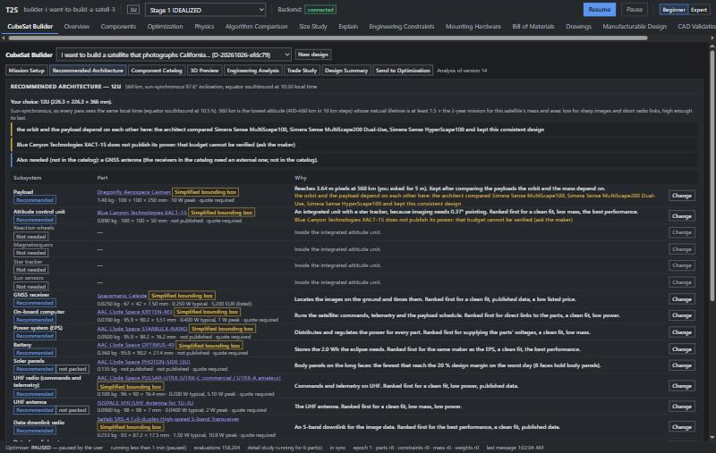
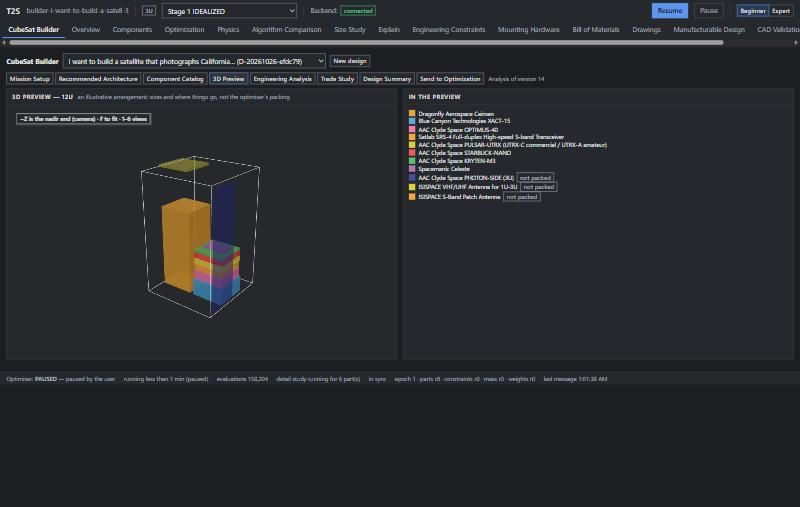
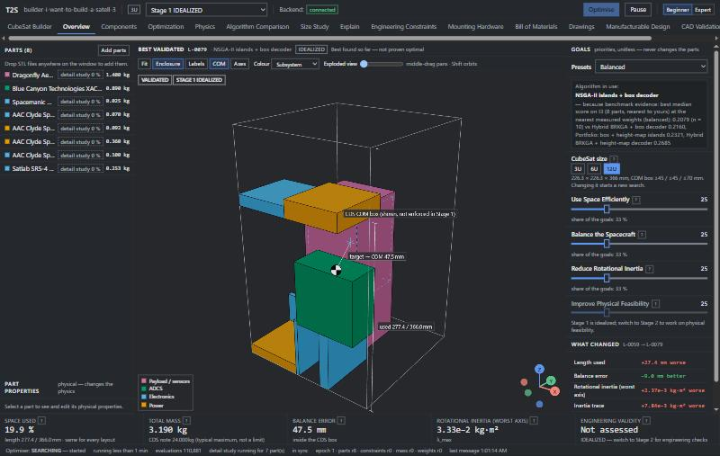

# V3 — the CubeSat Builder

V3 adds a **CubeSat Builder** tab in front of V2's packing optimiser: a beginner states a mission idea, answers
(or says "I don't know" to) a short adaptive questionnaire, and gets an engineering-informed CubeSat design — an orbit,
a size, real commercial parts with their sources, the analyses behind every number, compatibility checks, a 3D
preview, a trade study and a summary — which it can send on to the optimiser as a new project.

> **Conceptual design only.** Everything here comes from published data and simplified physics. The Builder never
> calls a design flight-ready: a flight design needs detailed analysis, environmental testing, licensing and an
> engineering review. Every value says where it came from; every default and modelling choice is marked ASSUMED.

Everything V2 does is unchanged; the Builder lives beside it (`backend/src/t2s/builder/`,
`frontend/src/builder/`, `frontend/src/tabs/Builder.tsx`).

## 1. The sections

| Section | What it shows |
|---|---|
| **Mission Setup** | A mission statement ("I want to build a satellite that photographs California from orbit") read by keyword rules, then one question at a time. Each question explains why it matters and what "I don't know" would take (the default, with its reason). Questions adapt: imaging questions only for Earth observation, "sites per day" only for chosen sites, the local time only for a sun-synchronous orbit. The requirements panel lists every value with its source: *You*, *From your description*, *Default (ASSUMED)*, *Derived*. Expert mode adds the advanced questions. |
| **Recommended Architecture** | The CubeSat size and orbit with the reasons, one row per subsystem slot: the part (linked to its maker's page), mass, size, power, price, its geometry origin, why it was picked, flags (e.g. "does not publish its power"), and a picker with the alternatives and why each was not picked. Then the compatibility checks, worst first. |
| **Component Catalog** | The 70 real parts, as published (unpublished values say "not published"; prices "quote required" unless listed). Each part's CAD situation and geometry, with *Import CAD…* and *Simplified shape*. Any part can be put into a slot that takes its kind. |
| **3D Preview** | The envelope with the parts as boxes in an illustrative arrangement (not the optimiser's packing): internal parts stacked in lanes, body panels on the long faces, antennas and sensors on the end faces, external hardware marked *not packed*, parts that do not fit in red. |
| **Engineering Analysis** | Every calculation in plain words — value, *meets* / *not met* / *cannot compute*, one sentence — with the working one click away (always open in Expert mode): the equation, every input with its source, the assumptions, the references (with links and access dates) and the fidelity (conceptual / preliminary). |
| **Trade Study** | The priority sliders (cost ↔ performance, mass ↔ capability, power, reliability, imaging, packaging), the mission lifetime, the CubeSat size (recommended or yours), and every size side by side with what fails. |
| **Design Summary** | The design on one page, every assumption to verify, and a Markdown download (requirements with sources, parts with links, budgets, analyses, checks, assumptions, references). |
| **Send to Optimization** | What will be packed and what will not, then a new optimiser project from the design; the project list switches the app between projects. |

Every change (an answer, a part, a slider, the size) is analysed again; until the new analysis is in, the old one is
dimmed and labelled with the design version it describes — stale results are never shown as current.

## 2. The California demonstration (run in the app, 2026-10-26)

The 16 steps of the brief, done through the real app (the verification server, port 8769) on design
`D-20261026-efdc79`:

| Step | What happened |
|---|---|
| 1. Imaging performance | The statement set *Earth observation* and *California* (32.5–42.0° N, 124.4–114.1° W). Questions answered: concept level, 2-year mission (I don't know → default), budget undecided, land and agriculture, **about 10 m pixels**, visible colour + near-infrared, chosen sites (5 a day by default); the rest by "Use the defaults for the rest" (20 of 20, each labelled). |
| 2. Orbit | Recommended: **sun-synchronous, 550 km, 97.6°, equator southbound at 10:30** — the lowest altitude (400–660 km) whose natural lifetime is ≥ 1.5 × the mission for this satellite (3.17 years for 4.20 kg; re-entry 1.17 years after the mission, within the FCC five-year rule). Longest eclipse 35.0 min; California in reach 1 a day (gap 24 h); UC Berkeley contact 22.6 min/day. |
| 3. Optics and pointing | Diffraction aperture for 10 m at 850 nm from 550 km: 57.0 mm (≤ 90 mm that fits); pointing needed 0.556°, knowledge 7.50″; swath 21.3 km; 0.250 GB of image data a day; SNR ≈ 133 (rough). |
| 4. Form factor | **6U** — the smallest size that passes every hard check (the trade study shows 1U–2U lack a structure and solar panels in the catalog, 3U is too full). |
| 5. Cameras | **Simera Sense MultiScape100**: 4.75 m at 500 km published → 5.22 m at 550 km; the other nine cameras each say why not (coarser, too big, size or power not published…). |
| 6. Subsystems | XACT-15 attitude unit (25″ worst axis; its power and knowledge are not published — flagged), Spacemanic Celeste GNSS, KRYTEN-M3 computer (direct links to every part), STARBUCK-NANO EPS + OPTIMUS-40 battery (same maker), one PHOTON-SIDE body panel (9 W — sized for the published loads only, about 1.1 W on average with the camera off between imaging sessions and the S-band radio off between passes; flagged, because the XACT-15's power is not published), PULSAR-UTRX UHF + ISIS antenna, Satlab SRS-4 S-band + ISIS patch, GomSpace NanoStructure 6U. |
| 7. Budgets | Mass 4.20 kg (5.04 kg with the 20 % margin) of 12 kg; power +32.7 % on the worst day (without the XACT-15, whose power is not published → *insufficient information*); battery need 2.07 Wh of 40 Wh; data: S-band 5,423 Mbit/day = 271 % of the daily images; listed prices 5,200 EUR, 11 parts need a quote. |
| 8. Maker CAD | 14 parts have a public CAD file on their maker's site (listed with sizes in §5.4 — **downloads await your approval**); others "on request", "after registration" or none found. |
| 9. Simplified CAD | The Caiman's simplified bounding box (100 × 100 × 250 mm, labelled *Simplified bounding box*) made in the catalog; Send makes the rest. |
| 10. Inventory | The architecture table and the summary's parts list (each linked to its source). |
| 11. 3D preview | Shown (see below). |
| 12. Compatibility | 0 incompatible, 5 insufficient information, 5 with assumptions (e.g. the 98.3 mm camera needs thinner walls than the 2 mm frame model; the camera and battery need thermal control for the −10.7…9.6 °C bounds), 44 compatible. |
| 13. Change a requirement | Pixel size 10 m → **5 m**. |
| 14. Updated design | Still 6U, now the **Dragonfly Caiman** (3.58 m at 550 km); pointing need 0.37°; a new *incompatible*: the Caiman's published 10–30 °C range does not cover the −1.2 °C orbit average. Sending this 6U was **refused**: the Caiman's 100 mm body equals the 6U's 100 mm side and the optimiser keeps every part strictly inside. In the Trade Study the size was set to **12U**: the Caiman at 560 km (3.64 m), 5.22 kg, +33 % power, 273 % data, no failing checks. |
| 15. Send to Optimization | Sent as project `builder-i-want-to-build-a-satell-3` (12U, 8 parts: the 3 external parts not packed); the app switched to it. Its `builder.json` lists the 7 constraints the optimiser does not enforce. |
| 16. Optimised arrangement | NSGA-II islands + box decoder: certified Stage 1 layouts within a minute — L-0059: all 8 parts, 250 of 366 mm used, 19.9 % of the volume, 3.19 kg packed, centre of mass inside the CDS box (56.5 mm from target); L-0079 then 47.5 mm. |

## 3. How it works

### 3.1 Requirements (`builder/questions.py`, `intake.py`)

About 40 declarative questions, each with: when it applies, the requirement it sets, how to read the answer
(choice, multi, number with presets, yes/no, region box, ground station), and its default with the reason (ASSUMED).
Answers are kept even when a question stops applying, so switching back restores them. A design is JSON
(`data/builder/designs/<id>.json`), every change versioned (`<id>.history/`). The mission statement is read by
keyword rules (no language model): a single leading mission type, a named region (California), night / video / fire.
Questions not answered when the analysis runs take their documented defaults and are listed as open.

### 3.2 Analyses (`builder/analysis/`)

| Area | What is computed | Model and sources |
|---|---|---|
| Orbit | period, speed, sun-synchronous inclination, eclipse, region access and revisit, station passes | two-body + J2 (NSSDCA J2, WGS 84); Sun from the low-precision almanac; cylindrical shadow; 7-day ground-track simulation every 10 s with J2 node drift; the year from the March 2027 equinox (ASSUMED) |
| Lifetime and disposal | natural lifetime (range for the smallest/largest face), years after the mission | circular decay in Vallado's exponential atmosphere, C_D 2.2 (ASSUMED), mean area = surface/4 (Cauchy); FCC five-year rule (89 FR 65217); solar activity not modelled |
| Imaging | diffraction aperture, aperture that fits, the camera's pixel and swath at the altitude, bands covered, scene and daily data, imaging time, pointing and knowledge needed, rough SNR | Rayleigh 1.22 λh/D; maker GSD scaled ∝ h; band names and published wavelength ranges; TSIS-1 550 nm irradiance; scene, optics and detector parameters ASSUMED |
| Power | average load (duty cycles), energy per orbit, worst-day generation, margin against a 20 % design margin, battery need | face-by-face illumination in the orbit frame for the year's beta angles; path efficiencies 0.65/0.85 and 30 % DoD (ASSUMED; NASA GRC LEO tests at 20–40 %) |
| Attitude | disturbance torques (gravity gradient, solar pressure, drag, residual dipole), momentum, slew torque, the unit's pointing and knowledge, magnetorquer authority | uniform box inertia; CDS CG ranges bound the CP offset (unverified source); residual dipole 0.01 A·m² (ASSUMED); IGRF-14 dipole |
| Communications | UHF and data downlink per day | Eb/N0 from EIRP, free-space loss at the mask range and ground G/T (Yagi or 3 m / 3.7 m dish, ASSUMED); uncoded BPSK 9.6 dB at 1e-5 + 3 dB margin; 80 % of each pass usable (ASSUMED) |
| Thermal | orbit-average nominal, hot and cold temperatures, the tightest part range | one isothermal node; ECSS-E-ST-10-04C albedo and Earth IR (means and extremes); α 0.9, ε 0.85 (ASSUMED) |
| Propulsion | Δv to hold the altitude, Δv to lower the orbit to a five-year decay, the thruster's Δv | drag deceleration × time; Hohmann (conservative); I_total/m or the rocket equation (a maker's Δv for an unstated mass is not compared) |
| Structure and budgets | mass against the CDS limit (with 5 % harness and the design margin, ASSUMED), inner volume used (≤ 70 %, ASSUMED), listed prices per currency, data returned | CDS Rev 14.1 mass limits; V2's frame model (2 mm walls, 8.5 mm rails) |

Each result is a traceable record (value, unit, equation, inputs with sources, assumptions, references, fidelity);
one that cannot be computed says what it needs. Checked against published values in the tests: sun-synchronous
inclinations of Landsat 8 (705 km, 98.2°, USGS) and Sentinel-2 (786 km, 98.62°, ESA) within 0.1°; the cylindrical
eclipse; 9.6 dB for BPSK at 1e-5; a black sphere at 1 AU ≈ 278 K; the camera pixel scaling; face illumination.

### 3.3 The architect (`builder/recommend.py`, `engine.py`)

For each slot (payload, attitude unit or wheels + magnetorquers + sun sensors, GNSS, computer, EPS, battery, solar
panels, UHF radio and antenna, data radio and antenna, propulsion, structure) the architect:

1. drops parts that cannot do the job (too big for the size; the wrong band; short of the pixel size or the pointing
   when another part reaches it — then the closest is taken and flagged);
2. prefers parts whose budget values are all published (mass, size, power), so the budgets can be checked —
   otherwise it flags what is unknown;
3. ranks the rest by the sliders: listed price (one currency at a time), mass, power, performance, volume, published
   data, fit, the maker's stated host sizes, and slot-specific links (the computer that talks to most parts directly,
   the EPS that supplies most parts' voltages, the battery of the EPS's maker, cameras that name the bands asked for).

Dependencies are followed in order: the payload sets the pointing class (an integrated unit with a star tracker below
1°), the daily data and the UHF link decide whether an S- or X-band downlink is needed, the lifetime and the FCC rule
decide propulsion, the loads decide the panels (the fewest that reach the design margin on the worst day) and the
eclipse decides the battery. The orbit follows the mass and the camera follows the orbit (the pixel scales with
altitude), so the passes repeat until both settle; when they flip between cameras instead, each candidate is held
fixed in turn and the consistent design that passes the most checks is kept. Every size from 1U to 12U is designed
this way; the smallest that passes every hard check is recommended (the user can choose another).

### 3.4 Compatibility (`builder/compat.py`)

One rule per kind of check, each giving **Compatible**, **Compatible with assumptions or modifications**,
**Incompatible** or **Insufficient information to verify** — an unpublished value is never compatible:
supply voltage (against the EPS's fixed, configurable and unregulated outputs), data interface (with the computer),
image data path, mechanical fit (inner frame model / rail envelope), the optimiser's packing model (Stage 1 / Stage 2),
external clearance (6.5 mm), temperature ranges, power, battery, data, pointing, momentum, knowledge, volume, mass
(with margin), lifetime, disposal, aperture, pixel size, bands, revisit, GNSS velocity limits, EPS input power,
propulsion Δv.

### 3.5 The catalog (`builder/catalog/`)

70 parts in 15 kinds (10 cameras, 2 integrated attitude units, 4 wheels, 2 magnetorquers, 3 star trackers, 3 sun
sensors, 5 EPS, 4 batteries, 5 solar panels, 8 radios, 5 antennas, 3 GNSS receivers, 5 computers, 7 structures,
4 thrusters), compiled on 2026-10-25 from the makers' own pages and datasheets (read-only, no sign-in). Every value
cites its source and access date; a value not published is `null`, never estimated; prices only where listed
(otherwise "quote required"); CAD availability as found. `catalog.validate()` checks that every value has a source.

### 3.6 CAD (`builder/cad.py`, `cad_worker.py`)

Every geometry says where it came from: **Manufacturer CAD**, **Reconstructed from drawings**, **Simplified bounding
box** (the published size) or **Placeholder** (a 20 mm cube when no size is published). The app never downloads CAD;
the user downloads a maker's file and imports it (STEP preferred; IGES, BREP, STL, or a .zip holding them). STEP, IGES
and BREP are read by OpenCASCADE in a separate isolated process with a time limit (300 s), units converted to
millimetres (a file declaring metres reads 1000 times larger, checked); STL units are matched against the catalog
size. The converter keeps the app's memory reserve (2 GB, `T2S_MEM_RESERVE_MB`, as every solve): it does not start
when the computer has less available, and it is stopped if the available memory falls below the reserve while it runs
(its whole process tree is measured and stopped: in a virtual environment on Windows, python.exe is a launcher that
runs the interpreter as its child).

The surface mesh is OpenCASCADE's own tessellation (BRepMesh, what CAD viewers display), through netgen.occ: on the
makers' assemblies it took seconds where gmsh took minutes or failed, and its meshes are far lighter (SAS-2: 36,276
triangles against gmsh's 999,022, both within 0.02 % of OpenCASCADE's volume). It is used when its triangles enclose
OpenCASCADE's solid volume within 2 % (or the file has no solids); otherwise gmsh meshes the file (Delaunay: gmsh's
default Frontal-Delaunay stalled for over 5 minutes on PULSAR-UTRX), with repairs only where needed: the file as it
is; OpenCASCADE's small-edge and small-face fixes only when that mesh fails; sewing only for a file of surfaces without
solids — run on every file, the healing merged the touching solids of the SS200 (3) and the SAS-2 (21) into loose
shells and left Celeste's faces with open boundary loops. Checks on every import: which model of an archive was used
and why; the file opens; it has solids; the tessellation (and for gmsh, the repair) used, with any faces that got no
triangles; the surface mesh is closed ("?" when the volume matches for an assembly whose solids touch, or where a few
faces got no triangles); the mesh volume matches OpenCASCADE's within 2 %; the size matches the catalog within 10 %.
The STL is centred (the shift is kept). The 3D preview draws a part with its imported model, turned so its sides lie as
its box does (`arrange.axisTurn`, a turn, never a mirror); a model of more than 400,000 triangles stays a box there.

Archives are unpacked safely (no absolute paths, `..`, backslashes or links; at most 200 MB in all), including a zip of
zips one level deep (AAC Clyde Space ships PULSAR-UTRX as one zip per variant). Makers often put a product family in
one archive (Optimus-30/40/80; Starbuck-Nano and Nano-PLUS), so the model used is the one whose name carries the
part's (`cad.pick_model`: the model code, e.g. OPTIMUS-40, then fewer variant words such as PLUS, then the largest);
when the names cannot tell, or the only model's name does not name the part, the "model" check says so (?) for the
user to verify. An archive holding several models is kept (`archive.zip`), and the Catalog's geometry details offer
the others (`POST …/cad/{id}/model`). Files live in `data/builder/cad/`, which git ignores: manufacturer CAD is
licensed by its makers and is never committed or pushed.

### 3.7 Send to Optimization (`builder/send.py`, `api/projects.py`)

Each send writes a new optimiser project `data/projects/builder-<design name>[-n]` — never overwriting one — with one
STL per internal part (imported CAD, else the simplified box), its catalog mass fixed (shown as the user's mass), its
subsystem, millimetre units, and the size, launch environment and target centre of mass as settings. A part the
optimiser could not place (not strictly smaller than the envelope) stops the send with the reason. The project's
`builder.json` records the design, version and inputs it came from, each part's catalog id and geometry origin, what
was not packed, and the constraints the optimiser does not enforce: external hardware (not in its mass or centre of
mass), fields of view (the camera must see out through the nadir end), centres of mass at the geometry's centre,
simplified shapes, connectors / harness / PC/104 stacking / thermal paths, the Builder's frame being its own model,
and the mass margins. The app then runs on the new project; the project list switches back at any time (the
coordinator stops and restarts on the chosen project; open pages reload).

### 3.8 Code

| Backend `t2s/builder/` | |
|---|---|
| `model.py`, `store.py` | the design record and its storage with versions |
| `questions.py`, `intake.py`, `regions.py` | the questionnaire, the statement reader, regions and stations |
| `catalog/` | the parts (`data/*.json`), accessors, `parse.py` (units of each maker's fields) |
| `analysis/` | `orbit`, `imaging`, `power`, `adcs`, `comms`, `thermal`, `propulsion`, `structure`, `budgets`, `refs` (constants and sources), `calc` (the record) |
| `recommend.py`, `engine.py`, `compat.py` | the architect, the analysis engine, the checks |
| `cad.py`, `cad_worker.py`, `send.py` | CAD import and simplified shapes, Send to Optimization |
| `api/builder.py`, `api/projects.py` | the endpoints (docs/api-contract.md §3.1) |

## 4. Tests

`backend/tests/test_builder_questions.py`, `test_builder_analysis.py` (published values, the catalog readers, the
architect, one test per compatibility rule, the California design, endpoints), `test_builder_cad.py` (STEP → STL
round trip, units, unreadable and surface-only files, an assembly keeping its solids, OpenCASCADE's tessellation and
its gmsh fallback, zip safety, zips of zips, the model an archive gives (on the makers' real archive listings) and
choosing another, the memory reserve, origins, endpoints), `test_builder_send.py` (new
projects never overwriting, masses and settings, refusals, imported CAD sent, switching projects and back).
Frontend: `builderSetup`, `builderAnalysis` (calculations, stale labelling, checks, picker, sliders, summary,
catalog, geometry), `builderArrange` (the preview arrangement), `builderSend` (the send view and the reload on a
project switch).

## 5. Limits and what to verify

### 5.1 Fidelity

Conceptual sizing with simplified physics: circular orbits, J2 only, a static exponential atmosphere (solar
activity changes lifetimes several-fold), a one-node thermal model, uncoded BPSK link margins, box-shaped parts,
bounding-box fits. The analyses are for comparing options, not for qualification.

### 5.2 Assumptions to verify (each is listed in the app)

Defaults taken for unanswered questions; scene and detector parameters of the SNR estimate; band wavelengths; the
aperture that fits each size; power path efficiencies and depth of discharge; the design margins (20 / 15 / 10 %) and
the 5 % harness allowance; the 70 % volume fill; ground station antennas and noise temperatures; the residual dipole;
surface absorptance and emittance; C_D; the CDS centre-of-gravity ranges (from a secondary source, not checked
against Rev 14.1); the UC Berkeley station location and mask (approved demo default, not the university's real
equipment).

### 5.3 Data gaps the app shows rather than fills

Several parts do not publish their power (e.g. BCT XACT-15, GomSpace NanoCom AX100), size or supply voltage; their
checks say *insufficient information*. The catalog has no 1U–2U structure, no 1U–2U solar panel, no AIS/ADS-B
receiver, no magnetometer and no GNSS antenna; the app names what is missing.

### 5.4 Maker CAD (downloaded 2026-10-26, with your approval)

These 14 public files (no sign-in) were downloaded over HTTPS into `data/builder/cad/downloads/<part>/` (git-ignored;
never committed or pushed). Every file's size matches the size its server announced, and its SHA-256 is recorded in
`downloads.json` there. "Model used" is what the importer takes from each archive (`cad.pick_model`, checked on the
archives' listings); **?** marks a pick for you to verify.

| Part | File (source) | Size | Model used |
|---|---|---|---|
| AAC Clyde Space iADCS400 | IADCS420-ASM-ST-1.0-defeatured-1.0_defeature.zip (aac-clyde.space) | 32.7 MB | **?** its only model is named IADCS420 (148 MB STEP) |
| AAC Clyde Space SS200 | SS200-20190325.zip (aac-clyde.space) | 0.16 MB | DEFEATURED SS200.STP |
| AAC Clyde Space KRYTEN-M3 | Kryten-OBC-CAD-models.zip (aac-clyde.space) | 8.5 MB | **?** two assemblies, 3D-25-02927 and 3D-25-02929 RevJ: the names do not say which; the larger is used |
| AAC Clyde Space ZAPHOD 6U | Zaphod-6U-Structure-CAD-model.zip (aac-clyde.space) | 4.7 MB | 3D-01-02747 RevC.STEP |
| AAC Clyde Space PULSAR-UTRX | PULSAR-UTRX-1.zip (aac-clyde.space) | 6.0 MB | a zip of two zips (amateur, commercial): the amateur UTRX model |
| AAC Clyde Space PULSAR-STX | CAD-01-00017-Rev-C.zip (aac-clyde.space) | 13.2 MB | **?** its only model is named by a drawing number (62 MB STEP) |
| AAC Clyde Space STARBUCK-NANO | Starbuck-CAD-models.zip (aac-clyde.space) | 12.3 MB | Starbuck-Nano (not the larger Nano-PLUS) |
| AAC Clyde Space OPTIMUS-40 | Optimus-CAD-models.zip (aac-clyde.space) | 32.4 MB | Optimus-40 (the archive also holds the -30 and the larger -80) |
| Satlab SRS-4 | SatlabSRS4v2_0_step.zip (satlab.com) | 2.7 MB | SatlabSRS4v2_0.STEP |
| Satlab SRX-8 | SatlabSRX8_v1_0_step.zip (satlab.com) | 20.9 MB | SatlabSRX8_v1_0.STEP (92 MB) |
| Satlab SAS-2 | Satlab_SAS-2_v1.0_step.zip (satlab.com) | 0.32 MB | Satlab_SAS-2_v1.0.STEP |
| SkyFox Labs piNAV-NG | piNAV-NG_Integration_Model.stp (skyfoxlabs.com) | 9.8 MB | the file itself |
| Spacemanic Celeste | cadmodel-celeste.zip (spacemanic.com) | 1.3 MB | celeste_gnss_rx_V3b_low_detail.step |
| Pumpkin BM2 | 710-01552-F Battery Module 2 (BM2).zip (pumpkininc.com) | 3.6 MB | 710-01552-F Battery Module 2 (BM2).step |

Before this run, the importer took the largest file of an archive (it would have imported the Optimus-80 and the
Nano-PLUS) and could not open PULSAR-UTRX's zip of zips; both are fixed (§3.6).

**Import status (2026-10-26): all 14 imported** through the checks (after the computer's RAM went from 16 to 32 GB;
the 2 GB reserve unchanged), measured:

| Part | Surface mesh | Solids | Triangles | Volume, mesh vs OpenCASCADE | Size, model vs catalog | Converter peak |
|---|---|---|---|---|---|---|
| SS200 | OpenCASCADE | 3 | 2,208 | 597 vs 597 mm³ (0.02 %) | ✓ 15.0 × 3.5 × 24.7 vs 24.66 × 15 × 3.5 mm | 59 MB |
| SAS-2 | OpenCASCADE | 21 | 36,276 | 54,093 vs 54,096 mm³ (0.01 %) | ✗ 80.0 × 100.0 × 16.4 vs 100 × 80 × 6.8 mm | 69 MB |
| Celeste | OpenCASCADE | 32 | 56,870 | 9,250 vs 9,251 mm³ (0.01 %) | ✓ 42.0 × 67.0 × 7.0 vs 67 × 42 × 7.5 mm | 198 MB |
| SRS-4 | gmsh (OpenCASCADE's triangles enclosed 82,452 mm³) | 10 | 266,382 | 66,853 vs 66,800 mm³ (0.08 %) | ✓ 87.2 × 93.0 × 18.0 vs 93 × 87.2 × 17.5 mm | 238 MB |
| BM2 | OpenCASCADE, 8 faces without triangles | 1 | 205,737 | 259,051 vs 259,826 mm³ (0.30 %) | ? no size published | 254 MB |
| ZAPHOD 6U | OpenCASCADE | 19 | 258,440 | 250,852 vs 249,842 mm³ (0.40 %) | ✓ 226.3 × 100.0 × 344.3 vs 100 × 226.3 × 340.5 mm | 549 MB |
| PULSAR-UTRX | OpenCASCADE, 1 face without triangles | 12 | 160,988 | 65,736 vs 65,741 mm³ (0.01 %) | ✗ 90.2 × 95.9 × 25.1 vs 96 × 90 × 16.35 mm | 451 MB |
| KRYTEN-M3 | OpenCASCADE | 242 | 58,260 | 24,351 vs 24,348 mm³ (0.01 %) | ✗ 90.2 × 95.9 × 23.2 vs 95.89 × 90.17 × 5.51 mm | 319 MB |
| piNAV-NG | OpenCASCADE, 13 faces without triangles | 305 | 99,738 | 6,442 vs 6,443 mm³ (0.01 %) | ✓ 10.5 × 71.1 × 45.7 vs 71.1 × 45.7 × 11 mm | 285 MB |
| STARBUCK-NANO | OpenCASCADE | 0 (surfaces only) | 52,466 | — | ✗ 90.2 × 95.9 × 23.2 vs 95.89 × 90.17 × 16.2 mm | 286 MB |
| PULSAR-STX | OpenCASCADE | 524 | 324,812 | 50,755 vs 50,752 mm³ (0.00 %) | ? no size published | 664 MB |
| SRX-8 | OpenCASCADE, 6 faces without triangles | 130 | 573,106 | 91,869 vs 91,837 mm³ (0.03 %) | ✓ 87.2 × 93.0 × 22.0 vs 93 × 87.2 × 22 mm | 1,150 MB |
| OPTIMUS-40 | OpenCASCADE, 8 faces without triangles | 293 | 143,688 | 132,055 vs 132,074 mm³ (0.01 %) | ✗ 90.2 × 95.9 × 36.4 vs 95.89 × 90.17 × 27.35 mm | 525 MB |
| iADCS400 (file: iADCS420) | OpenCASCADE, 9 faces without triangles | 0 (surfaces only) | 457,453 | — | ✗ 95.4 × 74.1 × 93.9 vs 95.4 × 95.9 × 67.3 mm | 1,305 MB |

What the checks found, to verify against the makers' drawings:
* **Thicker than published:** the four PC/104 boards — KRYTEN-M3 (23.2 vs 5.51 mm), STARBUCK-NANO (23.2 vs 16.2),
  PULSAR-UTRX (25.1 vs 16.35), OPTIMUS-40 (36.4 vs 27.35) — consistent with the models including the stacking
  connectors' pins, which a stack's pitch absorbs: packed one by one, these models overstate the stack's height. The
  SAS-2 is 16.4 mm against 6.8 mm.
* **Surfaces only:** the STARBUCK-NANO and iADCS420 files hold faces but no solids (even after sewing), so their mesh
  has no reliable volume; the catalog's mass is used as everywhere.
* **Which model:** KRYTEN-M3's two assemblies (3D-25-02927 and -02929 RevJ) imported at the same size (90.17 × 95.9 ×
  23.24 mm, 58,260 and 58,248 triangles): the default, the larger file, is kept. The iADCS400 page's file is the
  iADCS420 (74.1 mm where the iADCS400 is published at 67.3 mm). PULSAR-STX's file is named by its drawing number.
* **Preview:** SRX-8 (573,106 triangles) and iADCS420 (457,453) exceed the preview's 400,000-triangle limit and are
  drawn there as boxes.

### 5.5 Found along the way

* **V2, 6U:** in a 6U Builder project, 2 of the first ~120 NSGA-II box-decoder layouts were rejected by V2's
  validator, parts lying up to 63.147 mm (= (226.3 − 100)/2) outside the 100 mm side, as if the decoder had swapped
  the 6U's 226.3 mm and 100 mm sides. The validator caught both (nothing invalid was shown); the 12U demo had none.
  The cause in V2's decoder is not yet investigated.
* The optimiser's frame model (2 mm walls, 1.2 mm clearances) leaves 93.6 mm across a 1U–3U section: PC/104 boards
  (95.89 × 90.17 mm) fit its Stage 2 only standing on edge, not flat across the section as a real PC/104 stack sits,
  and the 98.3 mm Simera cameras fit only its idealized Stage 1 — the send warns about the latter.
